

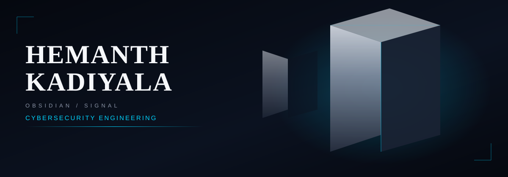

# OBSIDIAN SIGNAL — CYBERSECURITY / DIGITAL INTELLIGENCE

I am Hemanth Kadiyala, a cybersecurity student building practical skills in security monitoring, threat detection, DFIR, and security automation. My approach is evidence-led: learn fundamentals, investigate carefully, document findings, and keep improving.

## About Me

<table>
<tr>
<td width="60%" valign="top">

I am a cybersecurity student focused on security operations, threat detection, digital forensics and incident response, and security automation. My current work centers on building practical, evidence-based projects such as Cyber-Threat-Monitor, an evidence-first security monitoring and detection engineering platform.

I am developing skills through hands-on labs, documented investigations, and iterative project work. I avoid claiming expertise I have not yet demonstrated, and I prioritize reproducible results, testing, and clear technical documentation.

Academic background: cybersecurity student.

Career direction: cybersecurity engineering, SOC analysis, and defensive security.

</td>
<td width="40%" valign="top" align="center">

</td>
</tr>
</table>

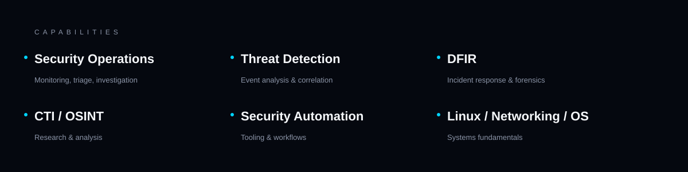

## Capability Landscape

Security Operations, Threat Detection, DFIR, Cyber Threat Intelligence and OSINT, Security Automation, and Linux, Networking, and Operating Systems. Each capability group is developed through practical projects and documented investigation.

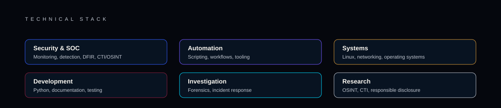

## Technical Stack

Grouped by purpose: security and SOC, automation, systems, development, investigation, and research. Technologies reflect current learning and project work; no proficiency levels are claimed.

## Featured Projects

### OpenCyberPath

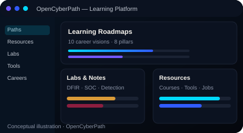

A free, community-curated cybersecurity learning hub with courses, labs, tools, career roadmaps, and job-preparation resources. Conceptual illustration.

What it does:
- Provides a searchable resource directory with topic icons, skill levels, and access labels.
- Offers ten career visions with prerequisites, modules, safe practice, and capstones.
- Includes labs, notes, threat-hunting exercises, and command references.
- Adds resume, jobs, and application practice tools in the browser.

Repository: https://github.com/hemanthkadiyala01-sentinel/open-cyber-path

### Cyber-Threat-Monitor

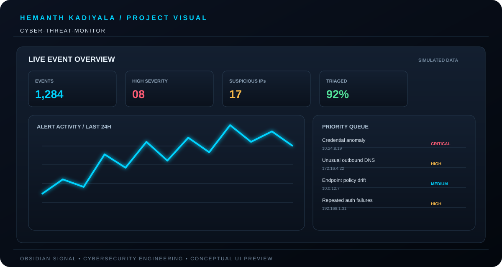

Evidence-first security monitoring and detection engineering platform built with React, Vite, FastAPI, Python, and SQLite.

What it does:
- Ingests Wazuh alerts and normalizes Windows process-creation events.
- Runs detection rules (DET-001 PowerShell, DET-002 Encoded PowerShell).
- Correlates alerts into host-based incidents with an evidence chain.
- Supports analyst lifecycle states and durable investigation notes.

Repository: https://github.com/hemanthkadiyala01-sentinel/Cyber-Threat-Monitor

### DARK-EYE

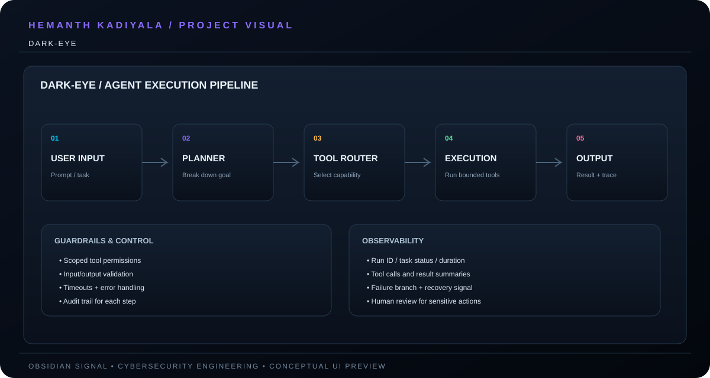

Security automation and AI agent engineering. Conceptual illustration; repository not yet published.

Repository: Not yet published

### SOC Detection Lab

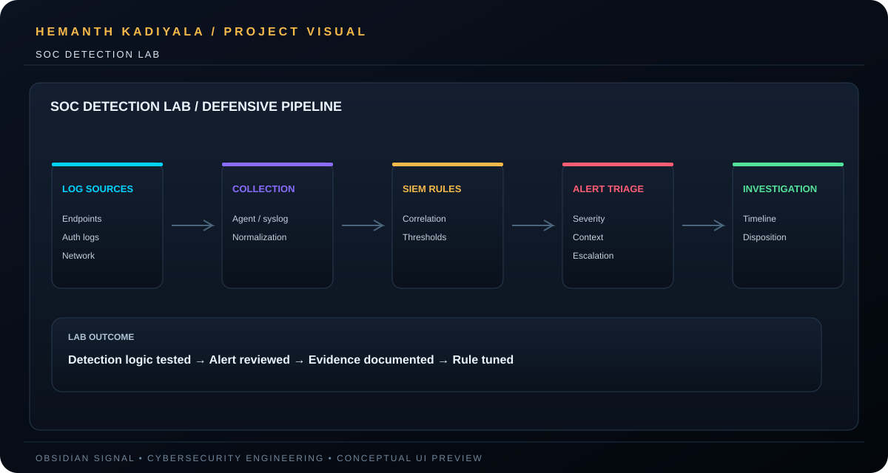

Monitoring, detection, and investigation. Conceptual illustration; repository not yet published.

Repository: Not yet published

### DFIR Case Studies

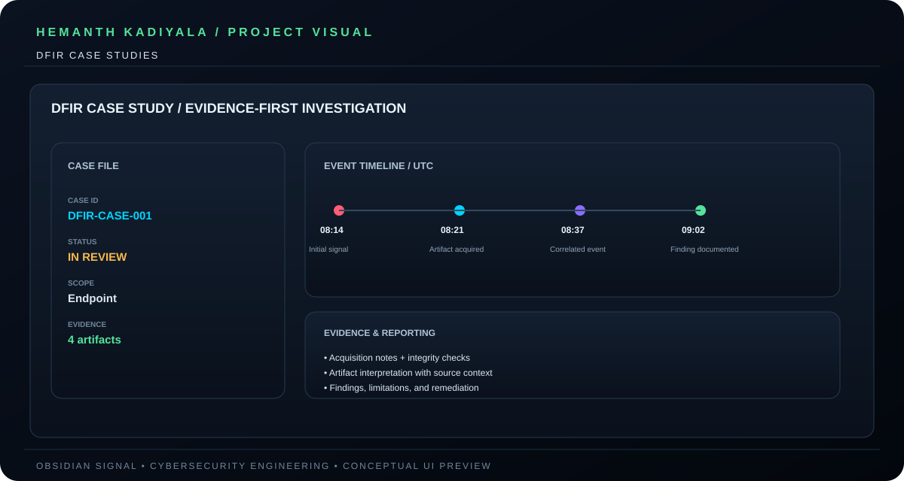

Authorized investigation and reporting. Conceptual illustration; repository not yet published.

Repository: Not yet published

### Linux and OS Fundamentals

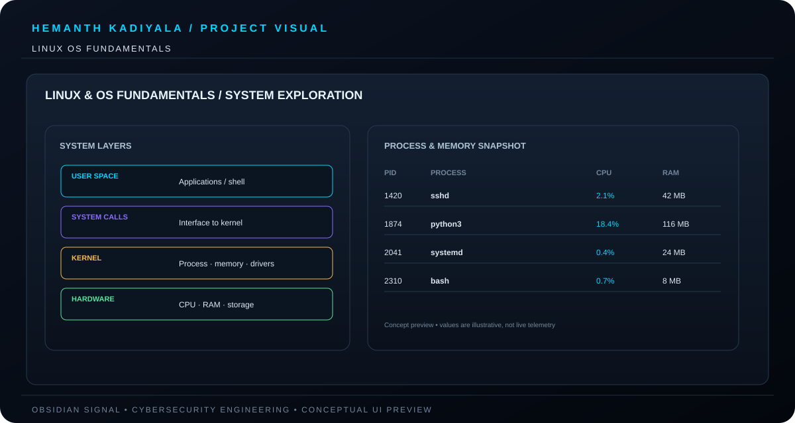

Practical Linux, operating system, process, and memory analysis labs for cybersecurity engineering.

Repository: https://github.com/hemanthkadiyala01-sentinel/linux-os-fundamentals

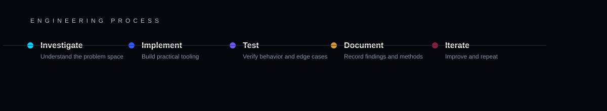

## Project Story and Engineering Process

Each project follows investigation, implementation, testing, documentation, and iteration. Achievements are described only where verified.

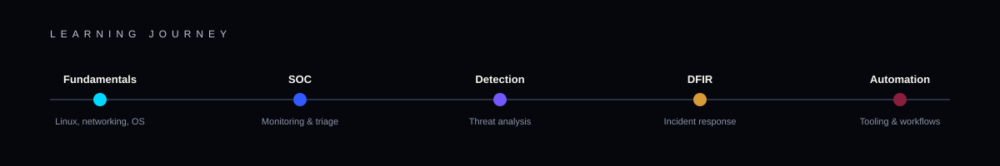

## Learning Roadmap

Planned progression; stages are goals, not completed achievements.

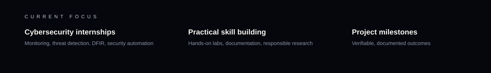

## Current Focus

Cybersecurity internships, practical skill building, and verifiable project milestones.

## Contact

- GitHub: https://github.com/hemanthkadiyala01-sentinel
- LinkedIn: https://www.linkedin.com/in/hemanth-kadiyala-8611a8358/
- Email: hemanthkadiyala01@gmail.com

